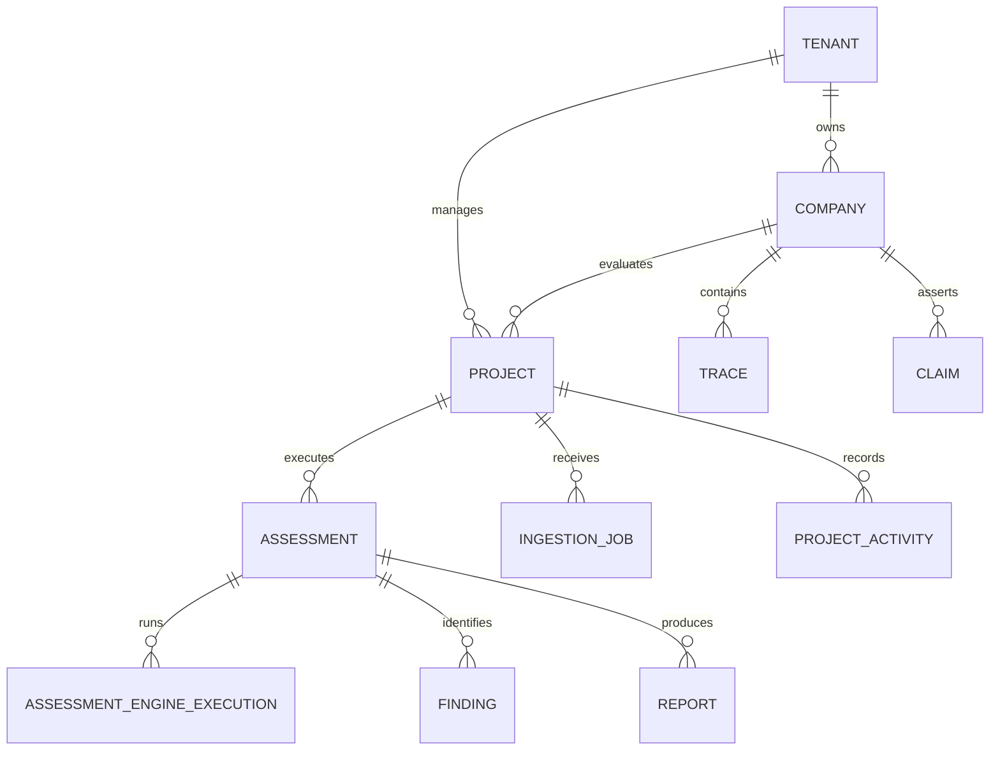

# Agentic Diligence (AGD) — Phase 9 Technical Repository Audit
**Document:** `docs/phase-09/architecture-audit.md`  
**Phase:** 9 — Complete Product Workflows  
**Author:** Principal Product Architect & Senior Staff Engineer  
**Date:** November 2026  
**Status:** Baseline Established & Verified  

---

## 1. Executive Summary & Objective

This repository audit establishes an objective, evidence-based technical baseline for **Phase 9: Product Engineering & Full Workflow Implementation**.

Agentic Diligence (`agentic-diligence` / `agd`) has evolved across Phases 1 through 8 from an epistemic evidence evaluation engine into a multi-page enterprise SaaS platform. While Phase 8 successfully introduced the enterprise design system, public product website, multi-page layout shell, and view controllers for the 10 analytical engines, critical workflows within the application experience remain partially implemented, simulated, or tightly coupled to sample scenarios:
1. **Onboarding & Project Creation:** Custom target creation in `/get-started` and `/app/projects/new` previously defaulted to executing benchmark Scenario A under the hood instead of persisting a real custom target.
2. **Telemetry Ingestion:** The telemetry modal only supported raw JSON pasting without drag-and-drop file ingestion, server-side format validation, progress tracking, ingestion job history, or project-level evidence management.
3. **Assessment Orchestration:** Evaluations were executed monolithically via `/api/v1/scenarios/{name}/run` rather than through an orchestrator that manages engine selection, execution state (PENDING, RUNNING, COMPLETED, FAILED), error isolation, and historical assessment retrieval.
4. **Project Lifecycle & Findings:** There is no dedicated `Project` entity to rename, update, archive, or track activity, nor a structured `Finding` register linked to specific evidence records.

This audit details what works, what is partially implemented, what is missing, and how to implement Phase 9 cleanly without breaking the 280-test regression baseline.

---

## 2. What Already Works (Verified Baseline)

### 2.1 Epistemic Foundations & Ingestion Pipeline
- **OTLP Trace Ingestion (`POST /v1/traces`):** Fully conforms to OpenTelemetry GenAI Semantic Conventions v1.28.0 (`app/ingestion/otel.py`, `app/ingestion/schema.py`).
- **Cryptographic Provenance:** Raw byte payloads are SHA-256 hashed *prior* to JSON deserialization (`PayloadProvenance` table, `app/db/models.py`), ensuring non-repudiation and RFC 8785 canonical manifests.
- **Unified Evidence Registry & Multi-Source Adapters:** Supports OpenTelemetry, Model Context Protocol (MCP stdio/SSE), and Browser Agent extensions (`app/adapters/`).
- **Durable Relational Persistence:** `DurableEvidenceRecord` with SQLite WAL mode, cold-start hydration, and duplicate detection (`app/adapters/registry.py`).
- **Enterprise Security & Auth:** API key authentication with SHA-256 key hashing, tenant isolation, and granular scope checks (`evidence:read`, `evidence:write`, `report:read`, `audit:admin`) in `app/security/auth.py`.

### 2.2 Ten Deterministic Analytical Engines
All ten analytical engines are deterministic, pure functions operating on SQLAlchemy database sessions and target IDs:
1. **Task Segmentation & Autonomy:** `analyze_human_intervention()` (`app/analysis/intervention.py`) and `segment_trace()` (`app/analysis/task_segmentation.py`). Separates sub-second algorithmic hops from human reaction latency (>30s) and tags unobserved intervals as `[UNKNOWN]`.
2. **Unit Economics & Token Efficiency:** `analyze_unit_economics()` (`app/analysis/economics.py`). Computes Cost Per Task (CPT), token input/output ratios, and latency percentiles (P50, P95, P99).
3. **Provider Dependencies & SPOF:** `analyze_provider_dependencies()` (`app/analysis/dependency.py`). Computes Herfindahl-Hirschman Index (HHI) and Potential Single Points of Failure.
4. **Failure Cascades & Retry Multiplier:** `analyze_failure_cascades()` (`app/analysis/cascade.py`). Quantifies economic overrun multipliers (1.8x–5.4x) on error loops.
5. **Tool Execution Risk & Blast Radius:** `analyze_tool_execution_risk()` (`app/analysis/tool_risk.py`). Categorizes tools into CRITICAL, HIGH, MEDIUM, and LOW privilege.
6. **Defensibility & Moat Analysis:** `analyze_defensibility_and_moat()` (`app/analysis/defensibility.py`). Scores cognitive scaffolding depth, model weight sovereignty, and calculates estimated months & USD to clone.
7. **Economic Stress Simulator:** `simulate_stress_test_economics()` (`app/analysis/stress_test.py`). Simulates 5x–10x volume surges, token price shocks (+25%), and human operator wages.
8. **AI Bill of Materials (AIBOM):** `generate_native_aibom()` and `export_cyclonedx_aibom()` (`app/aibom/generator.py`). Exports valid OWASP CycloneDX 1.6 / 1.5 JSON.
9. **Claim Verification Matrix:** `generate_claim_verification_matrix()` (`app/evidence/claim_matrix.py`). Pits stated vendor claims against measured runtime bounds. Emits `VERIFIED`, `CONTRADICTED`, `PARTIALLY_VERIFIED`, and `INSUFFICIENT_EVIDENCE`.
10. **Target Comparison Matrix:** `compare_diligence_targets()` (`app/analysis/comparison.py`). Side-by-side comparative diligence between two targets.

### 2.3 Reporting & Deliverables
- **Canonical Markdown & Deal Memo:** `generate_investment_committee_memo()` (`app/analysis/memo.py`) producing Executive Buy/Pass/Conditional verdicts, red/yellow flags, and 100-day action plans.
- **Verifiable Bundle Assembly:** `create_diligence_bundle()` and `verify_diligence_bundle()` (`app/reporting/bundle.py`) creating zip archives with RFC 8785 canonical `manifest.json`.
- **PDF Due Diligence Report:** `generate_pdf_report()` (`app/reporting/pdf.py`).

### 2.4 Multi-Page Experience & Design System
- **Public Website (Experience A):** 7 high-converting semantic HTML5 pages (`/`, `/product`, `/capabilities`, `/how-it-works`, `/trust`, `/docs`, `/get-started`).
- **Application Shell (Experience B):** Collapsible sidebar, topbar breadcrumbs, company switcher, and client router (`app-router.js`) in `app/ui/templates/app.html`.
- **Design Tokens:** Complete dark enterprise design system in `app/ui/static/css/design-system.css`.
- **Test Suite:** 280 tests currently passing (268 baseline + 12 Phase 8 tests).

---

## 3. What Is Partially Implemented

| Component | Current State | Defect / Limitation | Required Phase 9 Behavior |
|---|---|---|---|
| **Onboarding Wizard** (`/get-started`) | Renders benchmark and custom radio options. Benchmark executes scenario_a through scenario_j. | When "Custom" is selected, it silently executes `scenario_a?sample_size=20` and loads AcmeAI instead of creating a real custom target. | Path A runs sample scenarios with clear disclosures. Path B creates a genuine custom target, initializes its scope, and redirects to the empty project ready for ingestion. |
| **New Evaluation Wizard** (`/app/projects/new`) | Form collects target name and role. | Like `/get-started`, the submit action silently calls `scenario_a` under the hood. | Calls dedicated backend endpoint `POST /api/v1/projects` with target system metadata, scope, and objectives. |
| **Telemetry Upload Modal** (`app.html`) | Textarea accepting JSON payload, posting to `/v1/traces`. | No file drag-and-drop, no multi-file support, no format validation, no upload progress indicator, no ingestion history table, and no project association. | End-to-end file upload with drag-and-drop, client/server file validation (.json, .jsonl), size limits, ingestion progress, duplicate detection, and project-linked `IngestionJob`. |
| **Analytical View Controllers** (`app-router.js`) | Views fetch `GET /api/v1/companies/{id}/package` and display cards. | If a project is new or has no traces yet, views either crash on undefined keys or show blank panels without guidance. | Reusable component states: Loading, Empty State with "Ingest Traces to Run Engine" CTA, Error State, and Execution Status. |
| **Report Generation** (`/app/projects/{id}/reports`) | Displays IC memo text and buttons to download PDF / Bundle. | Generates report on-the-fly dynamically; does not maintain historical snapshots of previous assessments or distinct assessment versions. | Explicit report generation from persisted assessments, supporting historical retrieval and format downloads. |

---

## 4. What Is Missing

1. **Project Lifecycle Model (`Project` & `ProjectActivity`):**
   - No database table or API for renaming, updating target system, configuring assessment scope, archiving, or auditing activity events.
2. **Unified Assessment Orchestration (`Assessment` & `AssessmentEngineExecution`):**
   - No way to initiate an assessment on a project, select a subset of engines, view execution progress per engine, isolate engine errors, or retrieve historical assessment records.
3. **Structured Findings Register (`Finding`):**
   - Findings exist only as embedded text strings inside the IC memo dictionary. They cannot be queried as standalone objects, filtered by severity (CRITICAL, HIGH, MEDIUM, LOW), or linked directly to evidence records.
4. **Ingestion Job Tracking (`IngestionJob`):**
   - While `PayloadProvenance` records SHA-256 byte digests, there is no job-level record tracking file uploads, filenames, processing times, or user-facing error logs.
5. **Project Dashboard Overview:**
   - The `/app` overview view currently hardcodes benchmark cards rather than dynamically summarizing real persisted projects, recent activities, and assessment statuses.

---

## 5. Existing APIs to Reuse

The following existing backend endpoints will be preserved and reused directly:
- `POST /v1/traces`: OTLP trace ingestion receiver (returns payload hash and span counts).
- `GET /v1/compatibility`: Integration compatibility matrix.
- `GET /api/v1/scenarios/{name}/run`: Ground-truth benchmark scenario runner.
- `GET /api/v1/companies`: Workspace company catalog.
- `GET /api/v1/companies/{id}/package`: Full diligence report package.
- `GET /api/v1/companies/{id}/metrics`: 8 canonical diligence metrics.
- `GET /api/v1/companies/{id}/claim-matrix`: Claim verification matrix.
- `GET /api/v1/companies/{id}/aibom/cyclonedx`: CycloneDX 1.6 / 1.5 JSON export.
- `GET /api/v1/companies/{id}/pdf`: PDF due diligence report generation/download.
- `POST /api/v1/companies/{id}/bundle`: Evidence bundle compiler on disk.
- `POST /api/v1/bundles/verify`: Evidence bundle cryptographic verifier.
- `GET /cockpit`: Legacy single-page technical cockpit fallback.
- `GET /api/docs`: OpenAPI Swagger UI.

---

## 6. Existing Database Entities & Phase 9 Extensions

### Existing Entities (Preserved):
- `Tenant`: Multi-tenant boundary.
- `Company`: Target system / corporate entity.
- `Trace`, `Span`, `HumanIntervention`, `CostEvent`: Telemetry data.
- `Claim`, `EvidenceRecord`: Pitch deck claims and epistemic records.
- `Report`: Stored report packages and PDF paths.
- `PayloadProvenance`: Raw byte SHA-256 cryptographic digests.
- `TenantApiKey`: API keys and scope permissions.
- `DurableEvidenceRecord`: Persistent multi-source evidence records.

### Phase 9 Entity Extensions:

1. **`Project`**:
   - `id`, `tenant_id`, `company_id`, `name`, `description`, `target_system`, `target_type`, `framework`, `assessment_scope`, `evaluation_objective`, `status` (ACTIVE, ARCHIVED, DRAFT), `created_at`, `updated_at`.
2. **`Assessment`**:
   - `id`, `project_id`, `company_id`, `name`, `status` (PENDING, RUNNING, COMPLETED, PARTIALLY_COMPLETED, FAILED, CANCELLED), `selected_engines`, `summary_findings`, `error_message`, `started_at`, `completed_at`, `created_at`.
3. **`AssessmentEngineExecution`**:
   - `id`, `assessment_id`, `engine_key`, `engine_name`, `status` (PENDING, RUNNING, COMPLETED, FAILED, SKIPPED), `duration_ms`, `result_json`, `error_details`, `evidence_count`, `executed_at`.
4. **`Finding`**:
   - `id`, `assessment_id`, `project_id`, `engine_key`, `title`, `description`, `severity` (CRITICAL, HIGH, MEDIUM, LOW, INFO), `confidence`, `evidence_references`, `recommendation`, `created_at`.
5. **`IngestionJob`**:
   - `id`, `project_id`, `company_id`, `filename`, `file_size_bytes`, `format`, `payload_hash`, `status` (SUCCESS, FAILED, PARTIAL, DUPLICATE), `traces_count`, `spans_count`, `error_message`, `created_at`.
6. **`ProjectActivity`**:
   - `id`, `project_id`, `activity_type`, `description`, `metadata_json`, `created_at`.

---

## 7. Technical Constraints & Risks

### Constraints:
- **No Heavy JavaScript Frameworks:** Preserve native HTML5 + vanilla ES6 client router in `app.html` / `app-router.js`. No React, Next.js, or npm bundler bloat.
- **FastAPI Native:** All APIs must use FastAPI `APIRouter`, Pydantic schemas, and SQLAlchemy ORM sessions.
- **SQLite Concurrency & WAL:** All writes must respect SQLite WAL concurrency safeguards (30s timeout, thread isolation).
- **Epistemic Invariant:** Never convert missing data into success; uninstrumented intervals remain `[UNKNOWN]`.
- **Zero Mock Data:** Benchmark scenarios must be clearly tagged as sample data; custom targets must never silently load benchmark figures.

### Risks & Mitigations:
1. **Risk:** Introducing `Project` could conflict with existing routes expecting `company_id`.  
   *Mitigation:* Create a 1-to-1 or 1-to-many relationship where `company_id` is foreign-keyed on `Project`. In `app-router.js` and API routes, support looking up a project by `project_id` or `company_id`. Auto-seed a `Project` for any legacy `Company` lacking one (`get_or_create_project_for_company`).
2. **Risk:** Running all 10 engines synchronously in an assessment could timeout on large trace sets.  
   *Mitigation:* Execute engines sequentially with per-engine error isolation in the assessment orchestrator service (`app/assessment/orchestrator.py`).
3. **Risk:** Breaking existing 280 test assertions.  
   *Mitigation:* Add new Phase 9 tables and endpoints alongside existing endpoints without altering signatures or contracts of Phase 1–8 code.

---

## 8. Proposed Phase 9 Implementation Sequence

- **Milestone 9.0:** Repository Audit & Implementation Plan (Completed).
- **Milestone 9.1:** Project Lifecycle Management (Models, CRUD API, and Projects Catalog).
- **Milestone 9.2:** Complete Onboarding (Disclosed benchmark runner + real custom target creation).
- **Milestone 9.3:** Telemetry & Evidence Ingestion (File drag-and-drop, validation, IngestionJob, evidence viewer).
- **Milestone 9.4:** Unified Assessment Orchestration (Assessment orchestrator, engine isolation, execution tracking).
- **Milestone 9.5:** Results & Findings Experience (Engine dashboards, shared finding cards, severity badges).
- **Milestone 9.6:** Report Generation (Persisted assessment snapshots, markdown/PDF/JSON exports).
- **Milestone 9.7:** Frontend Product Integration (Fluid workspace navigation, loading/empty/error states).
- **Milestone 9.8:** End-to-End QA, Regression Verification & Release Documentation.

