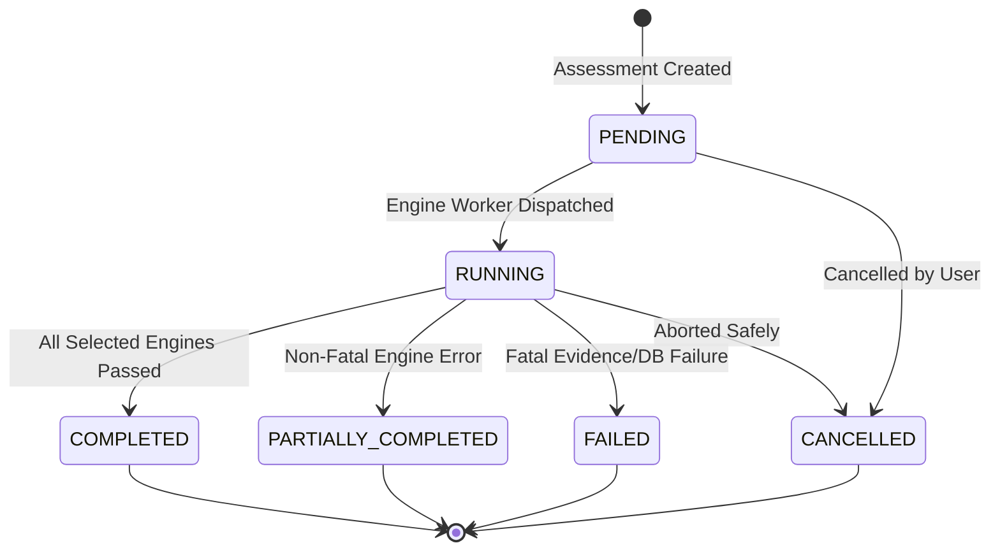

# Assessment Workflow & Engine Orchestration Architecture
**Document:** `docs/phase-09/assessment-workflow.md`  
**Phase:** 9 — Complete Product Workflows  

---

## 1. Assessment Lifecycle & State Machine

Every assessment transitions deterministically through the following states:



### State Definitions:
- **`PENDING`:** Assessment initialized and queued with specified engine selection.
- **`RUNNING`:** Engines are actively executing in dependency-respecting sequence.
- **`COMPLETED`:** All selected engines completed successfully; metrics and findings persisted.
- **`PARTIALLY_COMPLETED`:** Some engines succeeded, while one or more non-critical engines returned errors. The assessment preserves all completed engine outputs without crashing.
- **`FAILED`:** Fatal infrastructure failure (e.g. database disconnect, corrupt telemetry) prevented core evaluation.
- **`CANCELLED`:** Assessment terminated before completion.

---

## 2. Engine Execution Sequence & Error Isolation

Engines are organized into sequential execution phases to satisfy data dependencies:

```mermaid
flowchart TD
    subgraph Phase 1 : Foundational Runtime Analysis
        E1["Autonomy & HIR (analyze_human_intervention)"]
        E2["Unit Economics & CPT (analyze_unit_economics)"]
        E3["Provider Dependencies & HHI (analyze_provider_dependencies)"]
    end

    subgraph Phase 2 : Failure & Security Analysis
        E4["Failure Cascades (analyze_failure_cascades)"]
        E5["Tool Privilege Risk (analyze_tool_execution_risk)"]
        E6["AIBOM & CycloneDX (generate_native_aibom)"]
    end

    subgraph Phase 3 : Strategic & Moat Analysis
        E7["Defensibility & Moat (analyze_defensibility_and_moat)"]
        E8["Economic Stress Simulator (simulate_stress_test_economics)"]
        E9["Claim Verification Matrix (generate_claim_verification_matrix)"]
    end

    subgraph Phase 4 : Synthesis & Committee Verdict
        E10["Investment Memo & Deal Flags (generate_investment_committee_memo)"]
    end

    Phase 1 --> Phase 2
    Phase 2 --> Phase 3
    Phase 3 --> Phase 4
```

### Error Isolation Invariant:
Each engine is executed inside a `try/except` guard:
- If an individual engine fails (e.g., missing tool data or pricing rate unmapped), its execution is recorded as `status = "FAILED"` in `AssessmentEngineExecution` with the exact stack trace in `error_details`.
- Subsequent independent engines continue running.
- The parent assessment status is marked as `PARTIALLY_COMPLETED`, and the limitations are explicitly disclosed in the findings and report.
- Absence of evidence is tagged as `[UNKNOWN]`, never converted into a synthetic success.
