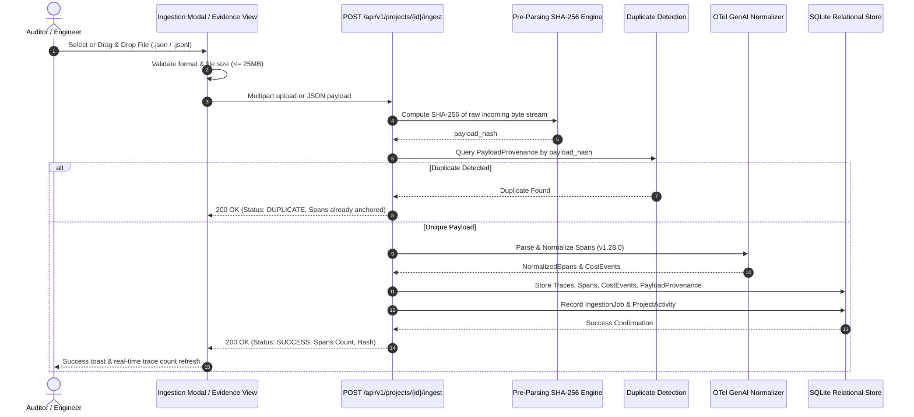

# Ingestion Workflow & Evidence Management Architecture
**Document:** `docs/phase-09/ingestion-workflow.md`  
**Phase:** 9 — Complete Product Workflows  

---

## 1. End-to-End Ingestion Pipeline

---

## 2. Ingestion Security & Data Integrity Controls

1. **Pre-Parsing Non-Repudiation:** Byte-level SHA-256 fingerprinting ensures evidence provenance cannot be tampered with after receipt.
2. **Path Traversal & Safe Filenames:** Uploaded filenames are sanitized (`os.path.basename` + strict regex `[a-zA-Z0-9_.-]`), preventing directory traversal (`../`).
3. **Hermetic Memory Containment:** Maximum batch size enforced at 25MB; streaming chunk parser prevents denial-of-service via unbounded payloads.
4. **Credential Scrubbing:** Pre-ingestion sanitizer scrubs incoming Authorization tokens, `sk-...` API keys, and private tokens from span attributes.
