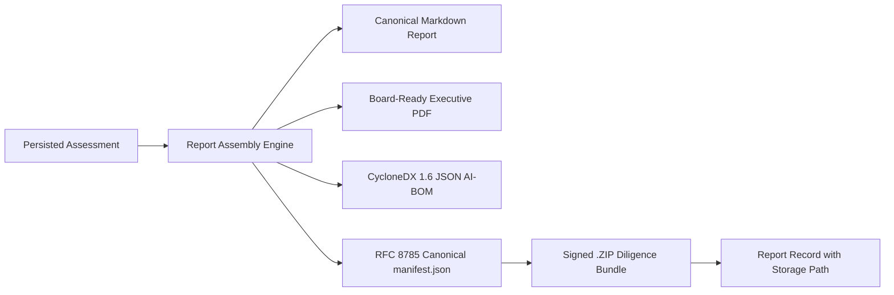

# Reporting Architecture & Deliverables Generation
**Document:** `docs/phase-09/reporting.md`  
**Phase:** 9 — Complete Product Workflows  

---

## 1. Persisted Assessment-to-Report Lifecycle

In Phase 9, reporting moves from purely on-the-fly ephemeral generation to an immutable, snapshot-based artifact workflow:

---

## 2. Report Sections & Standardized Layout

Every generated due diligence report contains 12 standardized sections:
1. **Executive Summary & Verdict:** Definitive Buy / Pass / Conditional recommendation, Red/Yellow/Green flag register, acquisition risk score.
2. **Target System Description:** Architecture, primary agent frameworks, system purpose, operational scope.
3. **Assessment Scope & Methodology:** Epistemic standards applied (T0–T3 ladder, 35% dark-zone threshold, sample sizes).
4. **Data & Evidence Provenance:** Cryptographic payload digests, trace observation windows, total span counts.
5. **Autonomy & Human Intervention Rate:** Explicit vs. inferred reaction latencies, lower bounded autonomy rate.
6. **Telemetry-Attributable Unit Economics:** Cost Per Task (CPT), token efficiency ratios, latency percentiles.
7. **Architecture & AI-BOM:** CycloneDX 1.6 software supply chain bill of materials.
8. **Dependencies & Cascades:** HHI provider concentration, single points of failure, retry cost overrun multipliers.
9. **Tool Execution Risk & Blast Radius:** Classification of bash/SQL write privileges, safety controls.
10. **Defensibility & Moat Analysis:** Scaffolding depth vs. commodity prompt wrapper analysis, cloning effort estimate.
11. **Economic Stress Simulator:** Volume surge and token inflation impact projections.
12. **Limitations & Action Plan:** 100-day engineering remediation roadmap.

