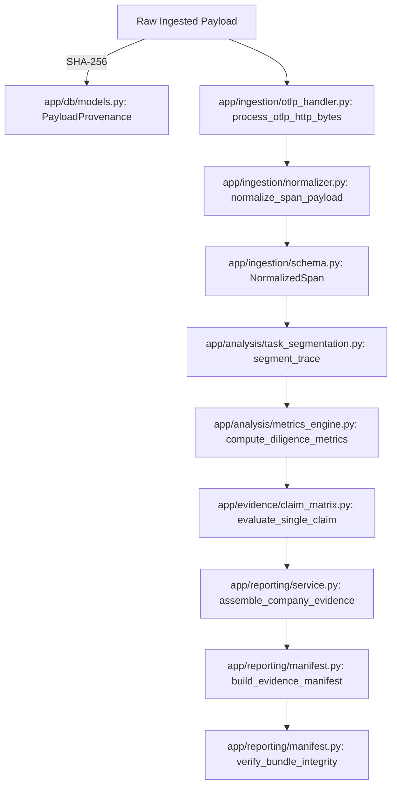
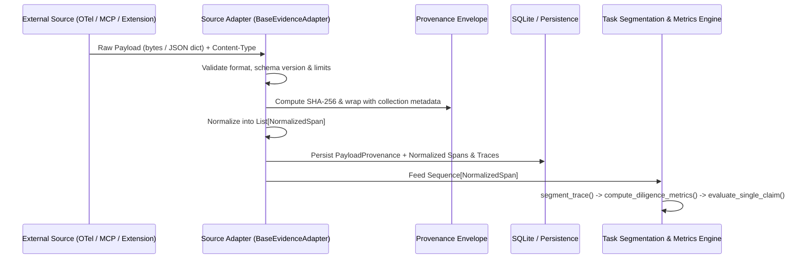
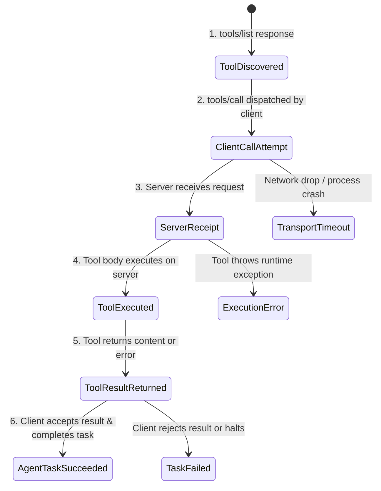

# Evidence-Adapter Architecture Specification

**Document Version:** `1.0.0`  
**Milestone:** Phase 5 — Milestone B (Architecture Specification)  
**Status:** DRAFT / PENDING IMPLEMENTATION REVIEW  
**Branch:** `feat/phase-05-ground-truth-mcp-extensions`  
**Baseline Test Suite:** 199 passing tests (0 failures, 3 non-blocking deprecation warnings)  
**Authors:** Senior Staff Engineer, Observability Architect & Adversarial Methodology Auditor  

---

## 1. Executive Summary & Architectural Motivation

Agentic Diligence (`agentic-diligence` / `agd`) is an evidence-first technical-diligence platform designed to verify empirical claims about autonomous AI agents. Up to Phase 4, the platform accepted telemetry exclusively via OpenTelemetry (OTEL) HTTP/JSON payloads (`POST /v1/traces`), converting raw OTel spans into normalized data models, segmented tasks, canonical metrics, epistemic claim evaluations, and signed integrity manifests.

However, modern AI agent systems execute across diverse runtime topologies:
1. **Orchestrator Frameworks:** LangChain, LangGraph, CrewAI, AutoGen, and custom Python loops.
2. **Protocol Interconnects:** Model Context Protocol (MCP) clients (e.g. Claude Desktop, IDE sidecars) and MCP servers providing external tools and resources.
3. **Execution Contexts:** Web browsers, browser extensions, desktop automation agents, and headless sandboxes.

Different evidence sources provide vastly different visibility, trust levels, and failure modes. For example:
- An MCP client can observe that it *dispatched* a tool request, but cannot independently verify whether the MCP server executed the tool safely or if intermediate network corruption occurred.
- A browser extension can observe user clicks and DOM mutations, but has zero visibility into the LLM prompts and reasoning chains executing inside a remote server.
- Framework callbacks can report that a task succeeded even when downstream tool effects failed.

### Core Epistemic Principles Preserved
1. **"Don't trust the claim. Verify what the available runtime evidence supports."**
2. **"Absence of evidence is not evidence of absence."** Never convert missing or unobserved evidence into zero, failure, or success.
3. **"Never label an inferred or assumed result as observed."** Maintain strict epistemic tagging: `[OBSERVED]`, `[CALCULATED]`, `[INFERRED]`, and `[UNKNOWN]`.
4. **"Do not invent competing metrics."** Adapters must not calculate their own definitions of autonomy, reliability, or completion. They simply normalize raw observations into the canonical pipeline.

---

## 2. Current Architecture & Code References

The existing Agentic Diligence codebase establishes a rigid, deterministic pipeline. The adapter architecture builds directly on these existing components without duplication or replacement:



### Verified Codebase Symbols & Contracts

| Pipeline Stage | Module & File Path | Key Classes & Functions | Current Invariants |
|---|---|---|---|
| **Raw Ingestion & Provenance** | [`app/ingestion/otlp_handler.py`](file:///c:/Users/adity/agentic-diligence/app/ingestion/otlp_handler.py) | `compute_raw_payload_hash()`, `extract_spans_from_otlp_envelope()`, `process_otlp_http_bytes()`, `PayloadProvenance` | Maximum payload limit (10MB); mandatory SHA-256 pre-parsing digest; rejects Protobuf binary (415). |
| **Semantic Normalization** | [`app/ingestion/normalizer.py`](file:///c:/Users/adity/agentic-diligence/app/ingestion/normalizer.py) | `normalize_span_payload()`, `flatten_otlp_attributes()`, `PROVIDER_ALIASES`, `OPERATION_NAME_ALIASES` | Conforms to OTel GenAI v1.28.0; tracks `unmapped_attributes`, `conflicts`, and `missing_fields`. |
| **Canonical Data Model** | [`app/ingestion/schema.py`](file:///c:/Users/adity/agentic-diligence/app/ingestion/schema.py) | `NormalizedSpan`, `NormalizedTrace`, `IngestionResult`, `NormalizationVersion` | Token 0 vs None distinction; `is_human_intervention`; `cost_usd`; explicit `EpistemicTag` and `TrustLevel`. |
| **Compatibility Registry** | [`app/ingestion/compatibility.py`](file:///c:/Users/adity/agentic-diligence/app/ingestion/compatibility.py) | `CompatibilityRecord`, `INTEGRATION_MATRIX` | Documents tested frameworks, observed attributes, and known limitations. |
| **Task Segmentation** | [`app/analysis/task_segmentation.py`](file:///c:/Users/adity/agentic-diligence/app/analysis/task_segmentation.py) | `segment_trace()`, `SegmentedTask`, `TaskOutcome`, `InterventionKind`, `TraceSegmentationResult` | Autonomous vs Human Explicit vs Human Inferred vs Unknown; unknown tasks widen `[lower, upper]` bounds. |
| **Deterministic Metrics** | [`app/analysis/metrics_engine.py`](file:///c:/Users/adity/agentic-diligence/app/analysis/metrics_engine.py) | `compute_diligence_metrics()`, `DiligenceMetrics` | Computes 8 canonical signals (AR, HIR, TCR, ER, TE, CPT, MC, TC) as `EpistemicValue` objects. |
| **Claim Verification** | [`app/evidence/claim_matrix.py`](file:///c:/Users/adity/agentic-diligence/app/evidence/claim_matrix.py) | `evaluate_single_claim()`, `generate_claim_verification_matrix()`, `ClaimVerificationMatrixEntry` | Strict non-None value enforcement (ADV-001); relative tolerance shortfalls (ADV-004); epistemic bounds checks. |
| **Evidence Bundling & Manifests** | [`app/reporting/manifest.py`](file:///c:/Users/adity/agentic-diligence/app/reporting/manifest.py) | `build_evidence_manifest()`, `verify_bundle_integrity()`, `canonicalize_json()` | RFC 8785 canonical JSON; path containment checks (ADV-002); duplicate path rejection (ADV-005). |
| **Reporting Service** | [`app/reporting/service.py`](file:///c:/Users/adity/agentic-diligence/app/reporting/service.py) | `assemble_company_evidence()`, `generate_company_bundle()` | Canonical JSON and Markdown parity; synthetic data labeling; cryptographic evidence references. |

---

## 3. Logical Architecture: The Evidence-Adapter Pipeline

To support heterogeneous agent frameworks, protocols, and runtimes without fragmenting our analysis pipeline, we introduce a four-stage normalized flow:

```
Source Adapter → Provenance Envelope → Canonical Evidence Model → Existing Analysis Pipeline
```



### Layer Responsibilities

#### Layer 1: Source Adapter
- **Format Ingestion:** Accepts source-specific payloads (e.g. OTLP JSON, MCP JSON-RPC logs, browser extension action events).
- **Validation:** Enforces maximum size bounds (default 10 MB), syntax correctness, and schema versioning.
- **Decomposition:** Unpacks framework-specific events into discrete, timestamped operations (model calls, tool requests, tool results, approvals, errors).
- **Capability Disclosure:** Formally declares what the source can observe and what is fundamentally outside its visibility.
- **Negative Invariant:** Adapters **must never** compute autonomy percentages, completion rates, or reliability scores.

#### Layer 2: Provenance Envelope
- **Cryptographic Hash:** Pre-parsing SHA-256 digest of exact raw payload bytes.
- **Timestamps:** Discloses both `source_timestamp_utc` (when the event occurred on the agent) and `ingested_at_utc` (when received by the diligence collector).
- **Source Identity:** Records adapter identifier, adapter semantic version, framework name, and framework version.
- **Epistemic Trust Level:** Assigns default trust level (`T0` vendor claim, `T1` self-reported, `T2` independent observer, `T3` attested) based on collection topology.
- **Redaction Ledger:** Notes any hashing, masking, or stripping performed on sensitive fields (e.g. prompt text, auth tokens).

#### Layer 3: Canonical Evidence Model
- **Schema Reuse:** Reuses [`app.ingestion.schema.NormalizedSpan`](file:///c:/Users/adity/agentic-diligence/app/ingestion/schema.py) as the universal atomic event representation.
- **Explicit Unknowns:** Missing tokens remain `input_tokens=None, has_token_data=False`; unobserved tool execution results remain `tool_status="UNKNOWN"`; absent human signals remain `is_human_intervention=False` with no human intervention span.
- **Trace & Span Correlation:** Preserves `trace_id`, `span_id`, and `parent_span_id`. When an upstream framework uses non-hexadecimal UUIDs or hierarchical strings, the adapter maps them deterministically while storing the original identifier in `raw_attributes["source_id"]`.

#### Layer 4: Existing Analysis Pipeline
- Normalized spans flow unmodified into [`app.analysis.task_segmentation.segment_trace()`](file:///c:/Users/adity/agentic-diligence/app/analysis/task_segmentation.py).
- Clustered tasks flow into [`app.analysis.metrics_engine.compute_diligence_metrics()`](file:///c:/Users/adity/agentic-diligence/app/analysis/metrics_engine.py).
- Metric `EpistemicValue` bounds flow into [`app.evidence.claim_matrix.evaluate_single_claim()`](file:///c:/Users/adity/agentic-diligence/app/evidence/claim_matrix.py).
- All conclusions generate evidence references tied to the raw payload hash.

---

## 4. Adapter Interface Contract

The adapter interface is defined as a minimal, typed Python class that requires no external dependencies. It lives in `app/adapters/base.py` and maintains complete backward compatibility with existing OTLP handlers.

```python
from dataclasses import dataclass, field
from datetime import datetime
from enum import Enum
from typing import Any, Dict, List, Optional, Sequence, Tuple
from app.ingestion.schema import NormalizedSpan, NormalizedTrace
from app.epistemic.tags import TrustLevel, EpistemicTag

class AdapterCapability(str, Enum):
    CAN_OBSERVE_TOOL_CALL = "can_observe_tool_call"
    CAN_OBSERVE_TOOL_EXECUTION_RESULT = "can_observe_tool_execution_result"
    CAN_OBSERVE_HUMAN_INTERVENTION = "can_observe_human_intervention"
    CAN_OBSERVE_TOKEN_USAGE = "can_observe_token_usage"
    CAN_OBSERVE_COST = "can_observe_cost"
    CAN_OBSERVE_MODEL_IDENTITY = "can_observe_model_identity"
    CAN_OBSERVE_SERVER_SIDE_ERRORS = "can_observe_server_side_errors"

@dataclass(frozen=True)
class ProvenanceEnvelope:
    adapter_id: str
    adapter_version: str
    source_framework: str
    source_version: str
    payload_sha256: str
    byte_size: int
    content_type: str
    ingested_at_utc: datetime
    epistemic_trust_level: TrustLevel
    capabilities: List[AdapterCapability]
    known_blind_spots: List[str]
    redacted_fields: List[str] = field(default_factory=list)
    custom_metadata: Dict[str, Any] = field(default_factory=dict)

    def to_dict(self) -> Dict[str, Any]:
        return {
            "adapter_id": self.adapter_id,
            "adapter_version": self.adapter_version,
            "source_framework": self.source_framework,
            "source_version": self.source_version,
            "payload_sha256": self.payload_sha256,
            "byte_size": self.byte_size,
            "content_type": self.content_type,
            "ingested_at_utc": self.ingested_at_utc.isoformat(),
            "epistemic_trust_level": self.epistemic_trust_level.value,
            "capabilities": [c.value for c in self.capabilities],
            "known_blind_spots": self.known_blind_spots,
            "redacted_fields": self.redacted_fields,
            "custom_metadata": self.custom_metadata
        }

class BaseEvidenceAdapter:
    """
    Abstract contract for all evidence adapters.
    Adapters convert raw source payloads into a ProvenanceEnvelope and canonical NormalizedSpans.
    """
    adapter_id: str = "base_adapter"
    adapter_version: str = "1.0.0"
    source_framework: str = "generic"
    source_version: str = "unknown"
    default_trust_level: TrustLevel = TrustLevel.T1

    def declared_capabilities(self) -> List[AdapterCapability]:
        """Returns the list of capabilities this adapter is certified to observe."""
        raise NotImplementedError

    def known_blind_spots(self) -> List[str]:
        """Returns limitations and unobservable regions for this adapter."""
        raise NotImplementedError

    def validate_payload(self, raw_bytes: bytes, content_type: str) -> None:
        """Validates payload boundaries, media type, and syntax."""
        raise NotImplementedError

    def parse_and_normalize(
        self,
        raw_bytes: bytes,
        content_type: str,
        company_id: str,
        provenance_hash: str
    ) -> Tuple[ProvenanceEnvelope, List[NormalizedSpan]]:
        """
        Parses raw payload, applies semantic normalization, and emits
        canonical NormalizedSpan objects with complete provenance.
        """
        raise NotImplementedError
```

---

## 5. Source Comparison Matrix: Capabilities, Blind Spots & Trust

| Dimension | LangChain / LangGraph | Model Context Protocol (MCP) | Browser Extensions |
|---|---|---|---|
| **Typical Collection Topology** | OpenTelemetry Tracer / Callback Handler running in agent process | `agd-proxy` intercepting JSON-RPC stdio/SSE between Client & Server, or Server logger | Content script / background service worker observing browser tabs |
| **Default Trust Level** | **T1** (Self-reported client telemetry) | **T2** if captured via independent proxy; **T1** if exported by client | **T1** for DOM actions; **T2** if actions validated via independent server API |
| **Observable Events** | Agent graph nodes, tool input arguments, tool returned outputs, prompt/completion token usage, LLM provider/model, chain error exceptions | Declared tool schemas (`tools/list`), call requests (`tools/call`), call results, error codes, transport latencies | User clicks, navigation events, extension tool triggers, explicit approval button clicks, visible page outcomes |
| **Fundamentally Unobservable (Blind Spots)** | Internal provider latency bottlenecks; actual tool execution environment (e.g. did OS script actually run?); uninstrumented human intervention outside Python process | Internal model thoughts/reasoning inside proprietary client; server internal implementation details; downstream network side-effects | Remote model execution, server-side tool execution, background worker tasks, activities in other uninstrumented tabs |
| **Human Intervention Signals** | Explicit Human-in-the-Loop approval nodes (`interrupt_before`, `interrupt_after`) | Interrupted tool executions or explicit human authorization tool call | Visible approval modal, user confirmation dialog, manual DOM override |
| **Supported Diligence Claims** | Token Efficiency (TE), Cost Per Task (CPT), Model Concentration (MC), Tool Error Rate (ER) | Tool reliability, tool invocation latency, protocol schema adherence, client retry behavior | User approval latency, human intervention frequency in browser UI, end-to-end task navigation completion |
| **Unsupported Claims (Requiring Corroboration)** | True Autonomous Execution (requires corroboration that human did not intervene out-of-band) | Total Agent Cost / Token Efficiency (MCP protocol does not transmit token usage counters) | Model Concentration, Token Efficiency, Server-side Cost |
| **Failure & Timeout Semantics** | Exception raised in tool callback; span marked with `status_code="ERROR"` | JSON-RPC error response `{"code": -32603, "message": "..."}`, or connection hang / EOF | Timeout waiting for DOM element; tab navigation crash; user rejected modal |

### Critical MCP Lifecycle Event Disambiguation

A primary source of diligence errors is conflating request attempts with verified execution. The MCP adapter enforces six strictly separated states:



1. **Tool Discovered:** The server advertised the tool via `tools/list`. *Does not prove the tool works or was ever invoked.*
2. **Client Call Attempt:** The client sent a `tools/call` JSON-RPC message. *Does not prove server receipt or execution.*
3. **Server Received:** The server parsed the message. *Observed only if proxy or server-side telemetry exists.*
4. **Tool Executed:** The tool code ran inside the MCP server environment.
5. **Tool Result Returned:** The server sent a JSON-RPC response with `content` or `isError: true`. *Does not prove the calling agent understood the output.*
6. **Agent Task Succeeded:** The overarching agent trace completed autonomously.

**Invariant:** In the absence of server-side or proxy evidence, a client-reported `tools/call` with no response has `tool_status="UNKNOWN"`, creating an unknown interval in task segmentation. It must **never** be recorded as completed or failed.

---

## 6. Trust & Evidence-Coverage Semantics

### Trust Level Attribution Rules (T0 to T3)
- **T0 (Unverified Vendor Stated Claim):** Vendor pitch-deck assertions, documentation claims, self-reported configuration files.
- **T1 (First-Party Self-Reported Telemetry):** Telemetry emitted directly by the agent runtime process (e.g. standard OpenTelemetry SDK inside LangChain). Can be manipulated by the agent author.
- **T2 (Second-Party Independent Observer):** Telemetry captured via an out-of-process intermediary (e.g. an OTel proxy, an MCP stdio monitor, an independent network tap). The agent cannot alter payload timestamps or hashes without detection.
- **T3 (Cryptographically Attested / Hardware Enclave):** Hardware-isolated execution logs signed by a trusted platform module (TPM) or secure enclave key.

### Coverage vs. Metric Separation
Evidence coverage must remain strictly independent of the metric value:
- **Task Telemetry Coverage (TC):** The percentage of segmented tasks backed by empirical `T1+` spans.
- **Dark-Zone Penalty:** If `unknown_fraction > 0.35` (more than 35% of tasks or intervals are uninstrumented), claims requiring autonomy or completion are capped at `PARTIALLY_VERIFIED` or `INSUFFICIENT_EVIDENCE`, even if the observed tasks had a 100% success rate.
- **Missing Telemetry:** If an agent executes 10 tasks, but telemetry was only captured for 3, the metric engine reports sample size $N=3$ with unknown fraction $0.70$. It does **not** assume the unobserved 7 tasks succeeded.

---

## 7. OTLP Backward Compatibility & Ingestion Preservation

The introduction of the evidence-adapter architecture strictly preserves all existing Phase 1–4 OTLP ingestion contracts:

1. **Endpoint Preservation:** `POST /v1/traces` in [`app/api/routes.py`](file:///c:/Users/adity/agentic-diligence/app/api/routes.py) continues to accept standard OpenTelemetry HTTP/JSON batches.
2. **The Reference Adapter:** The existing handler [`app/ingestion/otlp_handler.py`](file:///c:/Users/adity/agentic-diligence/app/ingestion/otlp_handler.py) becomes the canonical `OtlpEvidenceAdapter`, implementing `BaseEvidenceAdapter`.
3. **Database Schema Stability:** The SQLite/SQLAlchemy schema ([`app/db/models.py`](file:///c:/Users/adity/agentic-diligence/app/db/models.py)) remains unchanged:
   - `traces` table stores normalized trace metadata and `provenance_hash`.
   - `spans` table stores normalized span attributes.
   - `payload_provenance` table stores byte-level SHA-256 hashes, sizes, and formats.
4. **Deterministic Token & Cost Handling:** The exact rules for distinguishing 0 tokens from absent tokens, and pricing models via [`compute_span_cost()`](file:///c:/Users/adity/agentic-diligence/app/ingestion/otel.py), remain identical.
5. **Zero Regression:** All 199 existing tests in `tests/` pass with zero modifications to existing test assertions.

---

## 8. Security, Privacy & Redaction Boundaries

Evidence collection carries severe data leakage risks if prompt text, credentials, or proprietary intellectual property are ingested into diligence bundles. The adapter architecture enforces strict boundaries:

1. **Payload Redaction at Source:**
   - Adapters must support automated scrubbing of regex patterns matching API keys (`sk-[a-zA-Z0-9]{32,}`, `ghp_[a-zA-Z0-9]{36}`), Authorization headers, and bearer tokens.
   - Replaced tokens are recorded in `ProvenanceEnvelope.redacted_fields`.
2. **Path Traversal Defenses (ADV-002 / ADV-007):**
   - No adapter is permitted to read or write files outside designated bundle staging roots.
   - Path containment via `os.path.commonpath([bundle_root, resolved_path]) == bundle_root` is mandatory for all file-based adapters.
3. **Browser Privacy Constraints:**
   - Browser adapters must **never** record passwords, cookies, authorization headers, or full DOM trees by default.
   - Ingestion is restricted to user-authorized action envelopes with explicit URL/domain whitelisting.
4. **Preservation of Tenant Isolation Blocker (L-001):**
   - The platform remains restricted to local, isolated single-tenant auditing.
   - Any future multi-tenant adapter endpoint must require cryptographic bearer token validation and row-level tenant enforcement before deployment.

---

## 9. Error Handling & Incomplete Event Semantics

When an adapter encounters malformed, partial, or conflicting telemetry:

1. **Syntax / JSON Corruption:**
   - Record `PayloadProvenance` with `status="FAILED"`, error message, and payload SHA-256 hash.
   - Raise `IngestionError(status_code=400)`. Do not store partial phantom traces.
2. **Partial Spans within Valid Batch:**
   - Valid spans are normalized; corrupted individual spans are quarantined and counted in `IngestionResult.partial_success_rejected_spans`.
   - The overall ingestion status is marked `"PARTIAL"`.
3. **Conflicting Attributes:**
   - If a span defines both `gen_ai.system="openai"` and `llm.provider="anthropic"`, the normalizer follows priority precedence (OTel v1.28.0 first) and records the conflict in `NormalizedSpan.conflicts`.
4. **Dangling Children (Missing Parent Span):**
   - When a span specifies a `parent_span_id` that is not present in the trace, the span is retained as an orphan root task. It is not discarded.

---

## 10. Testing & Verification Strategy

The adapter architecture will be validated across three progressive stages:

1. **Contract Unit Tests (`tests/test_adapter_contract.py`):**
   - Verify `ProvenanceEnvelope` serialization, SHA-256 reproducibility, and capability declarations.
   - Test rejection of payloads exceeding 10 MB or containing malformed syntax.
2. **Ground-Truth Controlled Pilot (Milestone C):**
   - Execute a controlled local agent with 7 deterministic scenarios (autonomous tool completion, human intervention, tool failure + retry, complete failure, suppressed telemetry, duplicate events, provider fallback).
   - Verify that the pipeline outputs match independently recorded ground-truth labels.
   - Calculate False-Positive Verification Rate (FPVR) and False-Negative Verification Rate (FNVR).
3. **MCP Integration Harness (Milestone D):**
   - Run a mock MCP server with controlled tools (`calculate_tax`, `query_database`).
   - Validate that tool call attempts, tool receipts, tool results, and execution timeouts map to distinct, deterministic task segmentation outcomes.
4. **Browser Extension Schema Prototype (Milestone E):**
   - Validate event schema, consent boundaries, and sensitive data redaction.

---

## 11. Open Decisions & Implementation Roadmap

The following decisions are deliberately deferred to their respective milestones:

| Decision Area | Status | Resolution Milestone | Rationale |
|---|---|---|---|
| **LangChain Adapter Execution** | Pending | Milestone C | Use local deterministic Python script with real LangChain 0.2.6 tools and mock LLM to avoid external API costs and non-deterministic network flakiness. |
| **MCP Transport Mechanism** | Pending | Milestone D | Support local stdio JSON-RPC logging and HTTP SSE proxy envelopes; defer WebSocket and binary gRPC MCP transports. |
| **Browser Extension Implementation** | Specification Only | Milestone E | Define strict JSON event contracts and redaction rules; do not ship a Chrome/Firefox WebExtension binary in Phase 5. |
| **Multi-Tenant Authorization (L-001)** | Deferred | Phase 6 | Preserve existing deployment blocker. All Phase 5 pilots execute in isolated, single-tenant local environments. |

---

## 12. Verification & Architecture Review Sign-Off

- [x] All cited files, classes, models, and symbols exist in the repository.
- [x] Zero contradictions with Phase 1–4 data contracts or Phase 4.5 audit remediations.
- [x] OTLP HTTP/JSON backward compatibility confirmed.
- [x] Epistemic labels (`[OBSERVED]`, `[CALCULATED]`, `[INFERRED]`, `[UNKNOWN]`) strictly preserved.
- [x] No code changes made in Milestone B; regression baseline remains **199 passing tests**.

**Milestone B Status:** **PASS** (Ready for User Review prior to Milestone C implementation).
