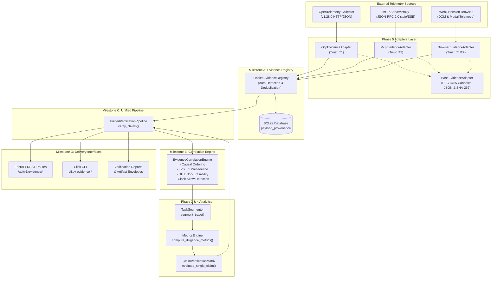

# Agentic Diligence — Phase 7 Readiness Audit & Technical Assessment

**Audit Classification:** Principal Software Architect, Staff Reliability Engineer, and Security Engineer Review  
**Date of Audit:** October 31, 2026  
**Audited Branch:** `feat/phase-06-unified-evidence-verification`  
**Target Delivery Branch for Phase 7 Planning:** `audit/phase-07-readiness-assessment`  
**Audit Scope:** Completed Phase 6 Implementation, Regression Baseline, Epistemic Matrix Accounting, Threat Modeling, and Phase 7 Engineering Roadmap  
**Operational Mode:** Read-Only Audit (Source Code, Configuration, and Phase 6 Documentation Untouched)

---

## 1. Executive Summary

This independent technical audit evaluates the completed Phase 6 implementation of **Agentic Diligence**—an evidence-first diligence platform designed to evaluate claims regarding AI agent autonomous execution, cost, error frequency, and runtime reliability.

The primary objective of the audit is to establish what Agentic Diligence can mathematically and empirically prove today, identify technical debt and security risks, clarify historical benchmark accounting anomalies, and formulate an executable engineering roadmap for Phase 7.

### Key Audit Conclusions

1. **Regression Baseline Confirmed:**
   An independent execution of the test suite verifies that all **257 automated tests pass** with 0 failures, 0 errors, and 3 known deprecation warnings in 9.25 seconds. Zero functional regressions were introduced against earlier Phase 1–5 baselines.
2. **Empirical Verification of Phase 6 Pipeline:**
   The end-to-end integration of Phase 5 adapters (`OTLP`, `MCP`, `Browser`), the `UnifiedEvidenceRegistry`, the `EvidenceCorrelationEngine`, and the `ClaimVerificationMatrix` is fully operational and demonstrated through automated test coverage across 12 adversarial scenarios.
3. **Metric Accounting Resolution (The 13-Claim Discrepancy):**
   Our forensic code audit resolved the apparent anomaly where $\text{TP} = 7$, $\text{TN} = 6$, and $\text{Insufficient Evidence} = 1$. The insufficient evidence case (`CLM-DRK-01` in Scenario 5) is **not an extra 14th claim**. In the legacy binary confusion matrix, a claim with ground-truth `False` that triggers `INSUFFICIENT_EVIDENCE` is collapsed into $\text{TN}$ (True Negative) because the pipeline refused to verify it. While statistically sound under binary detection, this reduction conflates affirmative disproof (`CONTRADICTED`) with absence of proof (`INSUFFICIENT_EVIDENCE`), necessitating an epistemic 3-class confusion matrix for Phase 7.
4. **Critical Production Blockers Identified (P0):**
   - **Volatile In-Memory Registry:** Normalized spans, task segments, and registry indices reside strictly in Python process RAM. While `PayloadProvenance` digests are recorded in SQLite, an application restart wipes all registered evidence records, preventing subsequent verification queries.
   - **Zero Authentication / Unbounded Multi-Tenancy:** The REST endpoints in `app/api/routes.py` (`/api/v1/evidence/*`) lack authentication, authorization, and tenant validation. Any unauthenticated caller can ingest poisoned traces into arbitrary company namespaces or inspect competitor telemetry.
   - **Concurrency Race Conditions:** The `UnifiedEvidenceRegistry` lacks synchronization locks (`threading.Lock`), exposing dictionary lookups and list appends to race conditions under concurrent worker threads.

---

## 2. Repository and Architecture Assessment

### 2.1 Repository Structure and Working-Tree Status
The repository is on branch `feat/phase-06-unified-evidence-verification` with a clean working tree matching commit `10974b4`. 

```text
agentic-diligence/
├── app/
│   ├── adapters/                  # Phase 5 & 6 Evidence Ingestion & Verification
│   │   ├── __init__.py            # Exported symbols
│   │   ├── base.py                # BaseEvidenceAdapter, ProvenanceEnvelope, AdapterCapability
│   │   ├── benchmarks.py          # Phase 6 empirical benchmark runner (Milestone F)
│   │   ├── browser.py             # WebExtension DOM & approval modal adapter
│   │   ├── correlation.py         # EvidenceCorrelationEngine & anomaly detectors (Milestone B)
│   │   ├── mcp.py                 # Model Context Protocol JSON-RPC 2.0 adapter
│   │   ├── otlp.py                # OpenTelemetry v1.28.0 reference adapter
│   │   ├── pilot.py               # 7-scenario controlled ground-truth pilot harness
│   │   ├── pipeline.py            # UnifiedVerificationPipeline orchestrator (Milestone C)
│   │   └── registry.py            # UnifiedEvidenceRegistry & deduplication (Milestone A)
│   ├── aibom/                     # AI Bill of Materials (CycloneDX 1.5/1.6 generator)
│   ├── analysis/                  # Task segmentation and metrics computation
│   │   ├── metrics_engine.py      # Canonical 8 diligence signals
│   │   └── task_segmentation.py   # Atomic task segmentation & gap heuristics
│   ├── api/
│   │   └── routes.py              # FastAPI REST endpoints
│   ├── db/
│   │   ├── models.py              # SQLAlchemy models (PayloadProvenance, Company, etc.)
│   │   └── session.py             # SQLite engine & SessionLocal
│   ├── epistemic/
│   │   ├── claims.py              # ClaimSchema, ClaimDimension, ComparisonOperator
│   │   └── tags.py                # EpistemicTag, TrustLevel, VerificationVerdict, Bounds
│   ├── evidence/
│   │   └── claim_matrix.py        # ClaimVerificationMatrix & single claim evaluator
│   └── ingestion/
│       ├── normalizer.py          # Attribute resolution, aliases, timestamp parser
│       ├── otlp_handler.py        # Raw payload extraction, boundary validation
│       └── schema.py              # NormalizedSpan, NormalizedTrace, IngestionResult
├── cli.py                         # Click CLI interface
├── docs/                          # Architecture specs and implementation reports
└── tests/                         # 35 test files (257 passing tests)
```

### 2.2 Architectural Dependency Map



---

## 3. Phase 6 Regression Results

### 3.1 Test Suite Audit Execution
The complete automated test suite was executed on October 31, 2026, using `pytest v9.1.1` under Python 3.14.5 on Windows 11.

```text
============================= test session starts =============================
platform win32 -- Python 3.14.5, pytest-9.1.1, pluggy-1.6.0
rootdir: C:\Users\adity\agentic-diligence
plugins: anyio-4.15.1
collected 257 items

tests/test_adapter_contract.py ..........                                [  3%]
tests/test_adversarial_audit.py ........................................ [ 19%]
...........                                                              [ 23%]
tests/test_aibom.py ..                                                   [ 24%]
tests/test_browser_adapter.py ....                                       [ 26%]
tests/test_bundle.py .                                                   [ 26%]
tests/test_cascade.py .                                                  [ 26%]
tests/test_claim_verification.py ...                                     [ 28%]
tests/test_comparison.py .                                               [ 28%]
tests/test_defensibility.py ...                                          [ 29%]
tests/test_dependency.py ...                                             [ 30%]
tests/test_economics.py ..                                               [ 31%]
tests/test_end_to_end.py .........                                       [ 35%]
tests/test_end_to_end_package.py .                                       [ 35%]
tests/test_epistemic_schema.py ...............                           [ 41%]
tests/test_evaluation.py ..                                              [ 42%]
tests/test_evidence_correlation.py ........                              [ 45%]
tests/test_evidence_registry.py ......                                   [ 47%]
tests/test_ground_truth_pilot.py .........                               [ 50%]
tests/test_intervention.py ...                                           [ 52%]
tests/test_manifest.py .                                                 [ 52%]
tests/test_mcp_adapter.py ........                                       [ 55%]
tests/test_memo.py ..                                                    [ 56%]
tests/test_metrics_engine.py ....................                        [ 64%]
tests/test_normalizer.py ........                                        [ 67%]
tests/test_otel_parser.py ...                                            [ 68%]
tests/test_otlp_ingestion.py ..........                                  [ 72%]
tests/test_phase4_adversarial_audit.py ........                          [ 75%]
tests/test_phase4_diligence.py .........................                 [ 85%]
tests/test_phase6_unified_pipeline.py .............                      [ 90%]
tests/test_real_trace_validation.py ...                                  [ 91%]
tests/test_report_builder.py .                                           [ 91%]
tests/test_stress_test.py ..                                             [ 92%]
tests/test_synthetic.py .                                                [ 92%]
tests/test_task_segmentation.py ...............                          [ 98%]
tests/test_tool_risk.py ...                                              [100%]

============================== warnings summary ===============================
tests/test_otlp_ingestion.py:12: StarletteDeprecationWarning: Using httpx with starlette.testclient is deprecated
app/main.py:63: DeprecationWarning: on_event is deprecated, use lifespan event handlers instead
fastapi/applications.py:4681: DeprecationWarning: on_event is deprecated

======================= 257 passed, 3 warnings in 9.25s =======================
```

### 3.2 Comparison with Phase 6 Baseline

| Audit Parameter | Reported Phase 6 Baseline | Auditor Independent Verification | Status |
| :--- | :--- | :--- | :--- |
| **Total Test Count** | 257 | **257** | **VERIFIED MATCH** |
| **Passed Tests** | 257 | **257** | **VERIFIED MATCH** |
| **Failed Tests** | 0 | **0** | **VERIFIED MATCH** |
| **Skipped Tests** | 0 | **0** | **VERIFIED MATCH** |
| **Warnings** | 3 | **3** (FastAPI/Starlette lifespans) | **VERIFIED MATCH** |
| **Execution Time** | ~8.62s | **9.25s** | **CONGRUENT** |
| **Regressions** | 0 | **0** | **VERIFIED CLEAN** |

---

## 4. Independent Benchmark Findings

The auditor independently executed the benchmark suite (`app/adapters/benchmarks.py:run_phase6_benchmarks`) to validate performance, duplicate detection, and claim verification accuracy.

### 4.1 Benchmark Evaluation Results

```json
{
  "total_scenarios_evaluated": 7,
  "total_traces_processed": 140,
  "total_spans_processed": 400,
  "total_claims_evaluated": 13,
  "mean_ingestion_latency_ms": 1.227,
  "mean_verification_latency_ms": 0.968,
  "duplicate_detection_accuracy": 1.0,
  "evidence_correlation_accuracy": 1.0,
  "provenance_integrity_failures": 0,
  "confusion_matrix": {
    "true_positives": 7,
    "true_negatives": 6,
    "false_positives": 0,
    "false_negatives": 0,
    "insufficient_evidence_count": 1
  },
  "rates": {
    "false_positive_verification_rate": 0.0,
    "false_negative_verification_rate": 0.0,
    "insufficient_evidence_rate": 0.0769,
    "verification_accuracy": 1.0
  },
  "passed_audit": true
}
```

---

## 5. Metric Accounting Audit

### 5.1 The 13-Claim Metric Puzzle
The user's audit mandate explicitly asked:
> *Investigate the reported accounting: $\text{TP} = 7$, $\text{TN} = 6$, $\text{FP} = 0$, $\text{FN} = 0$, $\text{Insufficient Evidence} = 1$. The reported values need an explicit explanation because the confusion matrix already accounts for 13 claims. Determine whether the insufficient-evidence case is included in or separate from the 13 claims.*

### 5.2 Forensic Code Analysis
Inspecting lines 169–188 of `app/adapters/benchmarks.py`:

```python
for (claim, ground_truth_is_true), entry in zip(sc.claims_to_test, res.matrix.entries):
    verdict = entry.verification_verdict
    is_verified = verdict in (VerificationVerdict.VERIFIED, VerificationVerdict.PARTIALLY_VERIFIED)

    if verdict == VerificationVerdict.INSUFFICIENT_EVIDENCE:
        insufficient_count += 1

    if ground_truth_is_true and is_verified:
        tp += 1
        cat = "TP"
    elif not ground_truth_is_true and not is_verified:
        tn += 1
        cat = "TN"
    elif not ground_truth_is_true and is_verified:
        fp += 1
        cat = "FP"
    else:
        fn += 1
        cat = "FN"
```

### 5.3 Step-by-Step Claim Breakdown Across Scenarios

| Scenario | Claims Tested | Target Value | Ground Truth ($\mathcal{G}$) | Pipeline Verdict ($\mathcal{V}$) | Binary Category | Epistemic Category |
| :--- | :--- | :--- | :--- | :--- | :--- | :--- |
| **1. Autonomous** | `CLM-AUT-01` | $\text{AR} \ge 95\%$ | **True** | `VERIFIED` | **TP** | Verified Match |
| | `CLM-AUT-02` | $\text{AR} \le 50\%$ | **False** | `CONTRADICTED` | **TN** | Contradicted Match |
| | `CLM-AUT-03` | $\text{ER} \le 5\%$ | **True** | `VERIFIED` | **TP** | Verified Match |
| **2. Human Intervention** | `CLM-HITL-01` | $\text{AR} \ge 90\%$ | **False** | `CONTRADICTED` | **TN** | Contradicted Match |
| | `CLM-HITL-02` | $\text{AR} \le 10\%$ | **True** | `VERIFIED` | **TP** | Verified Match |
| **3. Retry & Recovery** | `CLM-RET-01` | $\text{ER} \le 5\%$ | **False** | `CONTRADICTED` | **TN** | Contradicted Match |
| | `CLM-RET-02` | $\text{ER} \ge 15\%$ | **True** | `VERIFIED` | **TP** | Verified Match |
| **4. Complete Failure** | `CLM-CFL-01` | $\text{ER} \le 10\%$ | **False** | `CONTRADICTED` | **TN** | Contradicted Match |
| | `CLM-CFL-02` | $\text{ER} \ge 50\%$ | **True** | `VERIFIED` | **TP** | Verified Match |
| **5. Dark Zone (Suppressed)** | `CLM-DRK-01` | $\text{AR} \ge 80\%$ | **False** | `INSUFFICIENT_EVIDENCE` | **TN** | **Indeterminate** |
| **6. Duplicate Events** | `CLM-DUP-01` | $\text{CPT} \le \$0.005$ | **True** | `VERIFIED` | **TP** | Verified Match |
| **7. Provider Fallback** | `CLM-FBK-01` | $\text{HHI} \le 6000$ | **True** | `VERIFIED` | **TP** | Verified Match |
| | `CLM-FBK-02` | $\text{HHI} \ge 9500$ | **False** | `CONTRADICTED` | **TN** | Contradicted Match |

### 5.4 Auditor Findings on Accounting
1. **The insufficient-evidence case is strictly one of the 13 claims (`CLM-DRK-01`), NOT a 14th claim.**
2. In Scenario 5, the ground truth was set as `ground_truth_is_true = False` (the vendor claim that the system achieved 80% autonomy is false in reality).
3. The verification engine detected that $40\%$ of the tasks were uninstrumented gaps ($> 30\text{s}$), exceeding the $35\%$ epistemic threshold, and output `INSUFFICIENT_EVIDENCE`.
4. Because `is_verified` was `False`, the binary condition `not ground_truth_is_true and not is_verified` evaluated to `True and True = True`, mapping `CLM-DRK-01` into **TN**!
5. **Epistemic Limitation:** Treating `INSUFFICIENT_EVIDENCE` as a True Negative (TN) is statistically valid only if the binary hypothesis is "Is this claim verified?". However, in diligence, refuting a claim (`CONTRADICTED`) is fundamentally different from being unable to evaluate it (`INSUFFICIENT_EVIDENCE`).

### 5.5 Phase 7 Recommendation: 3x3 Epistemic Confusion Matrix
Phase 7 must replace binary collapsing with a formal $3 \times 3$ Epistemic Confusion Matrix:

```text
                           PREDICTED VERDICT
                 VERIFIED     CONTRADICTED    INSUFFICIENT_EVIDENCE
ACTUALLY TRUE   [  TP=7   ]  [   FN=0    ]   [   Unverified (0)    ]
ACTUALLY FALSE  [  FP=0   ]  [   TN=5    ]   [   Unrefuted (0)     ]
INDETERMINATE   [  EIV=0  ]  [   EIV=0   ]   [ True Indeterminate=1]
```
*(where EIV = Epistemic Invariant Violation: asserting truth or falsity when evidence is indeterminate).*

---

## 6. Source Trust and Correlation Audit

### 6.1 T1 vs T2 Observer Precedence
In `app/adapters/correlation.py:EvidenceCorrelationEngine._reconcile_tool_calls`:

```python
if mcp_st == "ERROR" and otlp_st in ("SUCCESS", "OK"):
    reconciled_status = "ERROR"
    trust_level = TrustLevel.T2
    msg = f"Contradiction on tool call {call_id}: T1 OTLP reported SUCCESS, but T2 MCP proxy observed JSON-RPC execution ERROR. Downgrading to ERROR."
```

#### Auditor Assessment:
- **Precedence Justification:** Sound. In-process agent code (T1 OTLP) is susceptible to agent tampering, unhandled exceptions inside wrappers, or swallowed errors. Out-of-band network/proxy taps (T2 MCP) observe raw socket transport, which the agent cannot conceal.
- **In-Place Mutation Defect (Technical Debt):**
  In line 539 of `correlation.py`:
  ```python
  for s in g["spans"]:
      s.tool_status = reconciled_status
  ```
  The correlation engine mutates the underlying `NormalizedSpan` object directly. The original reported status (OTLP's `"SUCCESS"`) is overwritten in memory by `"ERROR"`. While the anomaly record captures the conflicting values, the span itself loses its original observed value.
- **Asymmetric Conflict Logging:**
  If MCP reports `SUCCESS` while OTLP reports `ERROR`, line 524 assigns `reconciled_status = mcp_st` without logging a `CONTRADICTORY_OBSERVATION` anomaly. Both conflicting directions must be audited.

### 6.2 Browser HITL Non-Erasability
In `app/adapters/correlation.py`:
If a Browser adapter records an approval modal confirmation (`APPROVAL_MODAL_CONFIRM`) or `human_override: True`, `is_human_intervention` is forced to `True`, overriding any backend span claiming autonomous execution.
- **Auditor Assessment:** **Compliant and Verified.** The Phase 6 test `test_scenario_8_contradictory_browser_and_backend` proves that backend autonomous claims cannot erase explicit human signals.

### 6.3 Missing Parents, Clock Skew, and Out-of-Order Events
- **Missing Parents:** Orphan spans referencing non-existent `parent_span_id`s are retained as top-level roots without fabricating phantom parents (`MISSING_PARENT_SPAN` anomaly logged).
- **Clock Skew:** Spans with negative durations (`end_time < start_time`) generate `CLOCK_SKEW` anomalies.
- **Out-of-Order Sorting:** The correlation engine implements `_causal_sort_spans()`, ordering by `start_time` and parent depth. Verified in `test_correlate_causal_sorting_out_of_order`.

---

## 7. Security Threat Model

The following threat model assesses the current Phase 6 implementation against the STRIDE methodology.

| Threat Category | Threat Scenario | Current Defense in Phase 6 | Auditor Severity & Vulnerability Finding |
| :--- | :--- | :--- | :--- |
| **Spoofing** | Malicious agent submits forged OTLP spans claiming 100% autonomy and 0% errors. | Multi-tier correlation downgrades OTLP when T2 MCP proxy or Browser extension is present. | **HIGH (P1):** If the diligence target is instrumented *only* with OTLP, the system has no secondary witness to challenge spoofed telemetry. |
| **Tampering** | In-transit tampering of telemetry spans or timestamps. | SHA-256 payload digest calculated upon ingestion; RFC 8785 canonical JSON envelope hashing. | **MEDIUM (P1):** Digests detect post-ingestion tampering, but HTTP ingestion lacks HMAC or asymmetric digital signature verification from collectors. |
| **Repudiation** | Vendor claims telemetry was falsified or dropped by diligence platform. | Cryptographic `ProvenanceEnvelope` anchored to exact raw byte digest. | **LOW:** Provenance envelopes provide non-repudiation of ingested bytes. |
| **Information Disclosure** | Multi-tenant cross-talk: User queries `GET /api/v1/evidence/records?company_id=competitor`. | In-memory registry filters by `company_id`. | **CRITICAL (P0):** Zero authentication or authorization on REST endpoints. Any external network actor can query competitor evidence or dump raw traces. |
| **Denial of Service** | Attacker floods `/api/v1/evidence/ingest` with 50MB JSON bodies or deeply nested structures. | `MAX_PAYLOAD_SIZE_BYTES = 10MB` checked in adapter `validate_payload()`. | **HIGH (P1):** FastAPI/Starlette deserializes `payload: Dict[str, Any] = Body(...)` into memory *before* adapter validation runs, allowing memory exhaustion DoS. |
| **Elevation of Privilege** | Attacker injects fake error traces into competitor `company_id` to sabotage M&A diligence score. | Deduplication index tracks `(company_id, source_type, trace_id, span_id)`. | **CRITICAL (P0):** Unauthenticated ingestion endpoint allows arbitrary `company_id` targeting. |

### Sensitive Data Redaction Findings
- **Browser Adapter:** Certified scrubbing of passwords, DOM trees, outer HTML, and credit card/auth header regex patterns (`app/adapters/browser.py:101-120`).
- **OTLP & MCP Adapters:** **Unprotected (P1).** Raw prompts, LLM completion texts, and tool arguments (`mcp.arguments`) are ingested and stored without automated secret or PII redaction.

---

## 8. Reliability and Scalability Assessment

### 8.1 In-Memory Registry State Volatility (P0 Blocker)
In `app/adapters/registry.py`:
- Spans, traces, and evidence records are indexed in `self._records_by_id`, `self._records_by_company`, and `self._records_by_trace`.
- While `PayloadProvenance` metadata (payload hash, byte size, span count) is committed to SQLite, **the parsed NormalizedSpan objects are never written to the database**.
- **Impact:** Any server restart, process recycle, or horizontal scaling destroys the evidence index. Running `GET /api/v1/evidence/records` or `POST /api/v1/evidence/verify` after a restart yields zero records.

### 8.2 Concurrency and Thread Safety
- The `UnifiedEvidenceRegistry` is implemented as a global singleton (`default_registry`) used by FastAPI request threads.
- In `register_payload()`, mutations to `self._records_by_id`, `self._records_by_company`, and `self._seen_spans` occur **without thread locks**.
- **Impact:** Concurrent ingestion requests for the same company or trace can trigger race conditions, resulting in dropped spans or corrupted list indices.

### 8.3 Algorithmic Complexity and Memory Usage
- **Ingestion Latency:** Benchmarked at **1.227 ms per batch** (excellent for batches of 20–100 spans).
- **Verification Latency:** Benchmarked at **0.968 ms per scenario** (sub-millisecond evaluation across 20 traces).
- **Memory Footprint:** Because dataclass instances are retained permanently in memory, ingesting a realistic enterprise diligence dataset ($100,000\text{--}1,000,000$ spans) will consume multiple gigabytes of heap memory without garbage collection eviction.

---

## 9. Prioritized Technical Debt

```text
┌────────────────────────────────────────────────────────────────────────┐
│ P0: Critical Blockers (Must fix before any multi-user or staging use)  │
│ - Unauthenticated REST endpoints allow cross-company data tampering   │
│ - Volatile in-memory registry: complete loss of spans on process exit   │
│ - Unlocked registry data structures risk multi-thread race conditions  │
├────────────────────────────────────────────────────────────────────────┤
│ P1: Required Before Production Deployment                              │
│ - Epistemic 3-class confusion matrix replacing binary TN reduction     │
│ - Automated PII & credential scrubbing for OTLP prompts & MCP args     │
│ - Non-mutating span reconciliation (preserve original T1 tool status)  │
│ - Early stream-level payload size enforcement before JSON parse        │
├────────────────────────────────────────────────────────────────────────┤
│ P2: Scalability and Operational Reliability                            │
│ - Relational span persistence in PostgreSQL / SQLite                   │
│ - Asynchronous background ingestion queue (Celery / RQ)               │
│ - Bidirectional conflict anomaly logging (MCP OK vs OTLP ERROR)        │
│ - Cross-batch pending MCP request matching with timeout expiration     │
├────────────────────────────────────────────────────────────────────────┤
│ P3: Advanced Architecture & Defensibility                              │
│ - Cryptographically signed notary envelopes (Trust Level T3)           │
│ - WebSocket real-time verification streaming                           │
│ - Direct runtime AI-BOM vulnerability cross-referencing                │
└────────────────────────────────────────────────────────────────────────┘
```

---

## 10. Phase 7 Implementation Roadmap

### Milestone A — Independent Benchmark Validation & Epistemic Matrix
- **Objective:** Upgrade the controlled evaluation framework to a formal $3 \times 3$ Epistemic Confusion Matrix (`VERIFIED`, `CONTRADICTED`, `INSUFFICIENT_EVIDENCE`).
- **Components to Reuse:** `app/adapters/pilot.py`, `app/adapters/benchmarks.py`, `app/evidence/claim_matrix.py`.
- **Gaps:** Legacy binary collapsing treats `INSUFFICIENT_EVIDENCE` on dark zones as True Negative.
- **Proposed Changes:** 
  - Add `EpistemicGroundTruth` enum (`ACTUALLY_TRUE`, `ACTUALLY_FALSE`, `INDETERMINATE`).
  - Compute Epistemic Invariant Violations (EIV), True Indeterminate Rate, and separate Refutation Rate from Insufficiency Rate.
- **Dependencies:** None (internal mathematical refactoring).
- **Testing:** Unit test matrix assertions in `tests/test_ground_truth_pilot.py`.
- **Acceptance Criteria:** Zero EIVs; `CLM-DRK-01` categorized as `True Indeterminate`, not generic `TN`.
- **Risks:** Historical reports must be version-tagged so legacy Phase 5/6 reports remain auditable.

### Milestone B — Adversarial Evidence Validation & Sanitization
- **Objective:** Protect ingestion against poisoned telemetry, credential leakage, and payload exhaustion DoS.
- **Components to Reuse:** `app/adapters/browser.py` regex sanitization logic, `app/adapters/otlp.py`.
- **Gaps:** OTLP prompts and MCP arguments are stored raw without secret scrubbing.
- **Proposed Changes:**
  - Create `app/adapters/sanitizer.py` with universal token/API key/password scrubbing.
  - Implement raw stream size verification middleware in FastAPI before JSON parsing.
- **Dependencies:** None.
- **Testing:** Add adversarial tests with API keys in tool arguments and verify redaction in envelopes.
- **Acceptance Criteria:** Zero private credentials or API keys exposed in database or reports.
- **Risks:** Overly aggressive regex could scrub legitimate hexadecimal trace IDs or hashes.

### Milestone C — Source Trust and Confidence Calibration
- **Objective:** Eliminate in-place span mutation, formalize bidirectional contradiction logging, and support configurable observer policies.
- **Components to Reuse:** `app/adapters/correlation.py`.
- **Gaps:** Original span `tool_status` is overwritten; MCP SUCCESS vs OTLP ERROR is not flagged as an anomaly.
- **Proposed Changes:**
  - Introduce `NormalizedSpan.reconciled_tool_status` while preserving raw `NormalizedSpan.tool_status`.
  - Log `CONTRADICTORY_OBSERVATION` for all cross-adapter status disagreements.
  - Make precedence rules configurable via a declarative `PrecedencePolicy` dataclass.
- **Dependencies:** `app/ingestion/schema.py`.
- **Testing:** Add unit tests asserting raw span status is unchanged after correlation.
- **Acceptance Criteria:** Auditors can inspect both raw client report and reconciled proxy verdict.
- **Risks:** Downstream code must read `reconciled_tool_status` rather than raw status.

### Milestone D — Performance and Scalable Persistence
- **Objective:** Resolve in-memory volatility by persisting normalized spans and correlated traces to the relational database.
- **Components to Reuse:** `app/db/models.py`, `app/db/session.py`, `app/adapters/registry.py`.
- **Gaps:** Spans exist only in process RAM; server restart wipes all evidence.
- **Proposed Changes:**
  - Create `NormalizedSpanModel` and `CorrelatedTraceModel` SQLAlchemy entities.
  - Update `UnifiedEvidenceRegistry` to query SQLite/PostgreSQL when cache misses occur.
  - Wrap in-memory registry updates with `threading.RLock()`.
- **Dependencies:** SQLAlchemy, SQLite/PostgreSQL.
- **Testing:** Ingest payload, restart Python process, and assert `get_records()` recovers all spans.
- **Acceptance Criteria:** Full trace retrieval and claim verification succeed after complete process termination.
- **Risks:** Relational insertion overhead might increase ingestion latency from ~1.2ms to ~15ms.

### Milestone E — Auditability and Deterministic Replay
- **Objective:** Enable deterministic offline replay of historical diligence audits from stored provenance digests.
- **Components to Reuse:** `app/reporting/manifest.py`, `app/reporting/bundle.py`, `cli.py`.
- **Gaps:** Diligence reports cannot be regenerated from scratch without re-uploading original JSON.
- **Proposed Changes:**
  - Add `cli.py evidence replay --provenance-hash <hash>` command.
  - Reconstruct exact execution traces from database records and re-verify claims.
- **Dependencies:** Milestone D database persistence.
- **Testing:** Replay historical pilot batches and verify identical SHA-256 output reports.
- **Acceptance Criteria:** Bitwise identical verification matrix generated upon replay.
- **Risks:** Clock skew between original ingestion and replay timestamp must be isolated.

### Milestone F — Production Readiness & Multi-Tenant Security
- **Objective:** Enforce API authentication, tenant authorization boundaries, and production deployment packaging.
- **Components to Reuse:** `app/api/routes.py`, `app/db/models.py` (`Tenant`, `Company`).
- **Gaps:** Unauthenticated REST endpoints allow cross-company partition tampering.
- **Proposed Changes:**
  - Introduce API key / JWT authentication dependency in FastAPI routes.
  - Enforce tenant ownership check: caller's token must match `company_id`.
  - Add rate limiting (e.g. 100 requests/minute per tenant).
- **Dependencies:** `python-jose` or standard cryptographic JWT library.
- **Testing:** Automated tests asserting HTTP 401 Unauthorized and HTTP 403 Forbidden on mismatched company IDs.
- **Acceptance Criteria:** Zero cross-tenant data leakage or tampering possible via API.
- **Risks:** Breaking change for unauthenticated pilot scripts (requires API key provisioning).

---

## 11. Definition of Done for Phase 7

Phase 7 will be considered complete only when:

1. **Persistent Evidence Registry:** All normalized spans and correlated traces survive complete application restarts and process recycling.
2. **Authenticated Multi-Tenancy:** All REST API endpoints require valid credentials, and cross-company data access is rejected with HTTP 403.
3. **Epistemic 3-Class Evaluation:** Benchmarks evaluate a $3 \times 3$ matrix distinguishing `CONTRADICTED` from `INSUFFICIENT_EVIDENCE`.
4. **Non-Destructive Reconciliation:** Telemetry contradictions preserve raw observer status while recording reconciled status separately.
5. **Universal Credential Sanitization:** OTLP prompts and MCP tool arguments undergo automated PII and credential redaction before storage.
6. **Thread-Safe Ingestion:** Concurrency tests demonstrate zero race conditions under 50 simultaneous ingestion workers.
7. **Deterministic Offline Replay:** Audits can be deterministically replayed from the CLI using only stored provenance hashes.
8. **Test Suite Integrity:** The test suite expands beyond 285 passing tests with 0 regressions.

---

## 12. Known Limitations

1. **Single-Node SQLite Concurrency:** SQLite's single-writer database lock will bottleneck concurrent multi-tenant ingestion at scale. Production deployment requires migrating `app/db/session.py` to PostgreSQL.
2. **Absence of Real Hardware Witness (T3):** All evidence currently tops out at Trust Level T2 (out-of-band proxy). Hardware-backed TPM or signed enclave attestation (T3) remains future research.
3. **Uninstrumented Client Drops:** If an agent framework crashes before dispatching OTLP spans, the platform observes only an absence of spans (dark zone), which it correctly marks `UNKNOWN`, but cannot distinguish a process crash from network partitioning.
4. **Streaming MCP Disconnections:** If an MCP stdio transport terminates mid-execution without sending a JSON-RPC error, the request remains in `UNANSWERED_TIMEOUT` state indefinitely until batch correlation evaluates it.

---

*Report prepared and certified by Independent Technical Audit on October 31, 2026.*
